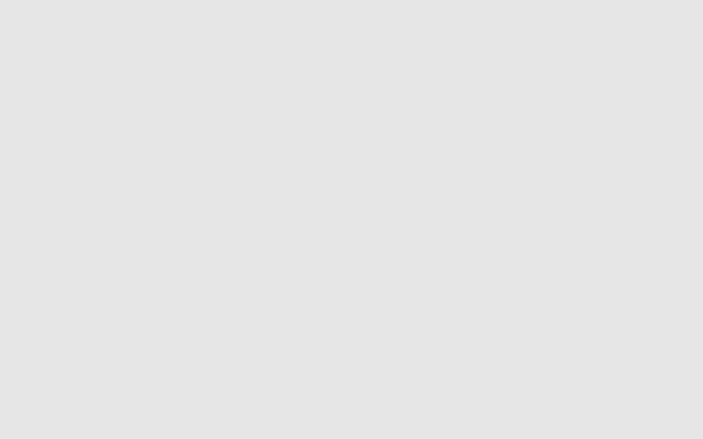

# Install screenshots

The files here are grey placeholders. Replace each one with the real screenshot, keeping its name, at the SPEC-019 live check with Captain. Agents can't take them: they need a fresh macOS 26 user account and a downloaded copy of the release zip.

## How to take them

- Use a fresh standard user account (Bluetooth permission is per user), macOS 26, light appearance.
- Download the zip from the Releases page in Safari, so the file is quarantined the way a real download is.
- Capture with Shift-Command-4, then Space, then click the window (no shadow: hold Option). Save as PNG, 1200 px wide or more.
- No personal data in any shot: no real name, email or other apps' windows.
- Write down exactly what each dialog says. The guide in the main README must match it word for word.

## Shot list (tick when the placeholder is replaced)

- [ ] `01-release-page.png`: The Releases page on GitHub with the Gaffer zip listed under Assets.
- [ ] `02-unzipped.png`: Downloads folder after double-clicking the zip: the zip and Gaffer.app side by side.
- [ ] `03-in-applications.png`: Gaffer.app in the Applications folder (Finder window).
- [ ] `04-blocked-dialog.png`: The dialog macOS shows on the first double-click, with its full text and buttons.
- [ ] `05-open-anyway.png`: System Settings, Privacy & Security, scrolled to the Security section with the Open Anyway button next to the Gaffer message.
- [ ] `06-confirm-open.png`: The second dialog after Open Anyway, with its Open button.
- [ ] `07-password.png`: The password or Touch ID prompt, if macOS shows one (skip the shot if it does not).
- [ ] `08-menu-bar.png`: Gaffer open: the light-bulb icon in the menu bar and the window listing lights.
- [ ] `09-bluetooth-prompt.png`: The first-scan prompt: "Gaffer" would like to use Bluetooth, with Allow and Don't Allow.
- [ ] `10-bluetooth-settings.png`: System Settings, Privacy & Security, Bluetooth, with Gaffer switched on.
- [ ] `11-control-click-open.png`: Control-click Gaffer.app, choose Open: record what macOS 26 does (works, or only offers Cancel). Needed to settle the guide's wording.

## Preview

